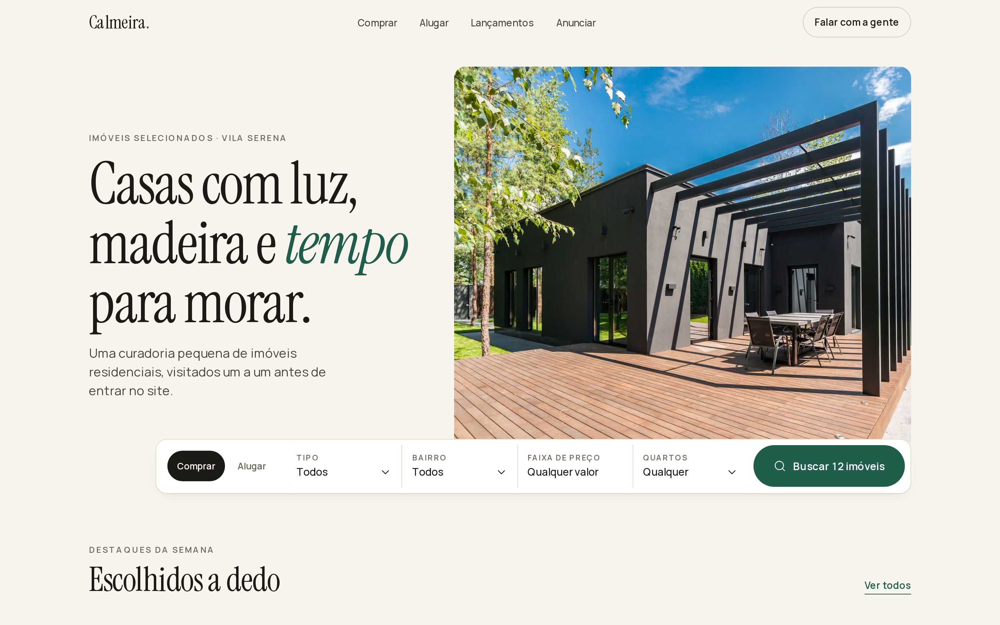
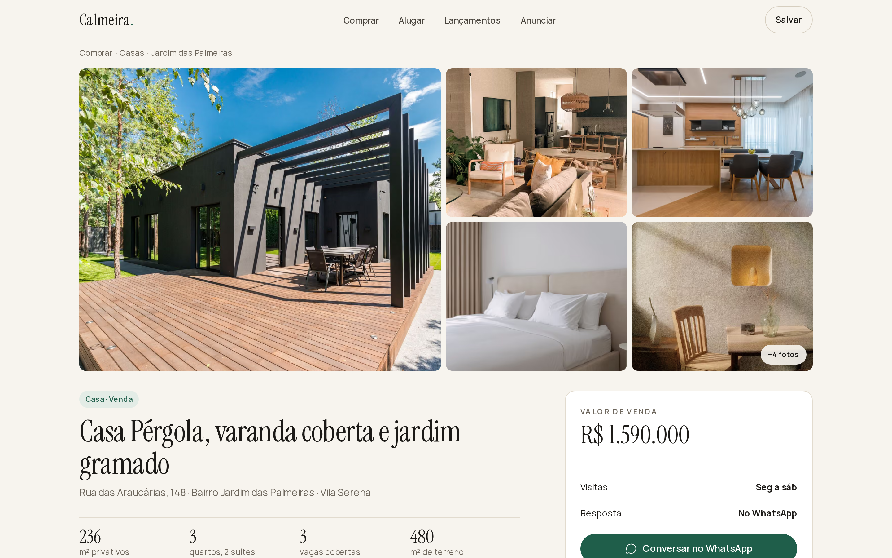
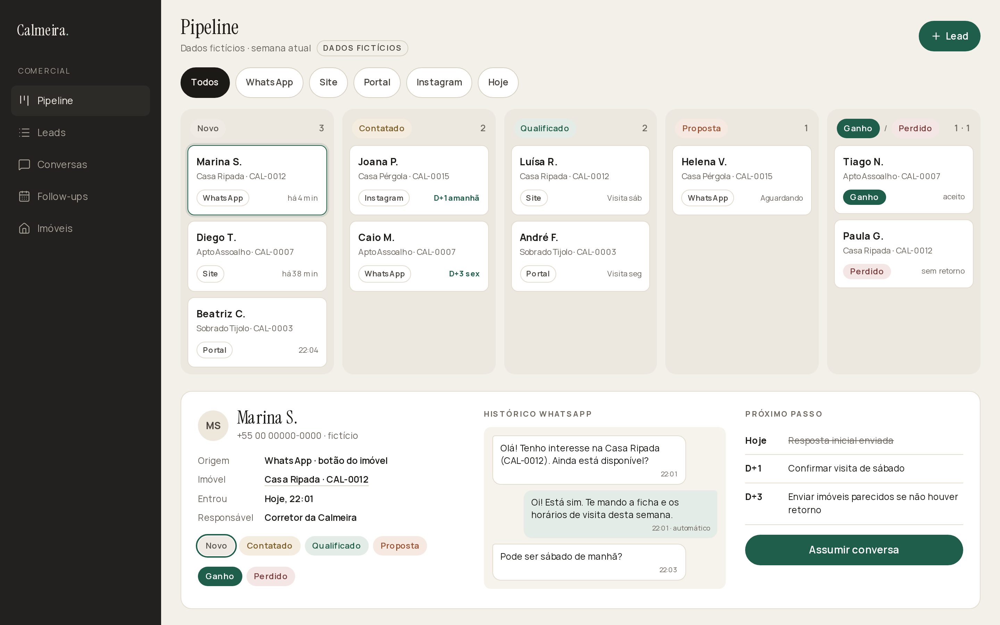
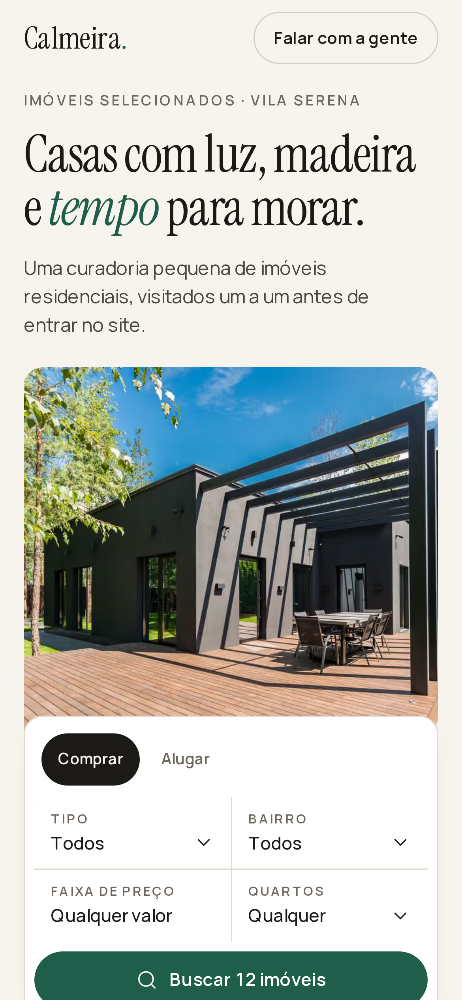

# Calmeira Imóveis — site + painel de leads (projeto conceito)

🔗 **Demo ao vivo:** https://demo-imobiliaria-delta.vercel.app

Projeto conceito de site para uma imobiliária **fictícia**. Marca, imóveis, valores e leads são dados fictícios. Nenhum backend, banco, API ou `.env`.



## O problema

Muitas imobiliárias pequenas dependem de portais e do WhatsApp solto: o cliente não acha os imóveis com facilidade e os contatos se perdem sem acompanhamento. A ideia aqui é mostrar um site com busca filtrável e botão de WhatsApp em cada imóvel, mais um painel simples para acompanhar cada lead até a proposta.

## Telas

| Imóvel | Painel de leads | Mobile |
|---|---|---|
|  |  |  |

## Stack

Next.js (App Router) · TypeScript · Tailwind CSS (design tokens próprios) · deploy na Vercel. Dados mockados em `data/*.ts`.

## Rodar

```bash
pnpm install
pnpm dev     # http://localhost:3000
pnpm build   # build de produção (usado pelo Preview da Vercel)
```

## Telas

| Rota | O que tem |
|---|---|
| `/` | Hero com foto, busca (Comprar/Alugar, tipo, bairro, faixa de preço, quartos) com contagem ao vivo, destaques, bairros, faixa de atendimento |
| `/imoveis` | Resultados filtrados pela query string (`op`, `tipo`, `bairro`, `preco`, `quartos`, `lancamento`) |
| `/imoveis/[id]` | Galeria com visualizador, ficha, preço e botão WhatsApp para `wa.me/5500000000000` (número fictício) |
| `/painel` | Pipeline Novo → Contatado → Qualificado → Proposta → Ganho/Perdido: arrastar card ou clicar no estágio, filtros por origem, lista de leads, histórico WhatsApp mock e próximo passo D+1/D+3 |
| `/creditos` | Créditos das fotos, fontes e ícones (espelha `LICENCAS.md`) |

## Estrutura

- `data/*.ts`: imóveis, leads, fotos e créditos (tudo fictício).
- `tailwind.config.ts`: só os tokens do design system. A paleta padrão do Tailwind é substituída, então `blue-*`, `green-*` etc. não existem.
- `components/`: header, rodapé, selo DEMONSTRAÇÃO, busca, card, galeria e painel.

Checagem de cor proibida (deve dar vazio):

```bash
rg "(blue|sky|indigo|cyan|emerald)-[0-9]|#25d366" -i app components data tailwind.config.ts
```


## Autor

Feito por **Estevam Juliano** — [LinkedIn](https://www.linkedin.com/in/estevam-juliano-8799b026b/) · [GitHub](https://github.com/Estevamjd)
